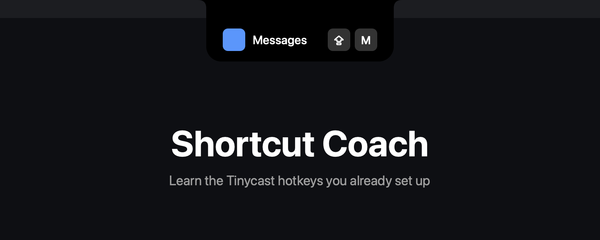

  

# Shortcut Coach

A menu-bar app for macOS that helps you build the habit of using the app-switching hotkeys
you set up in Tinycast.

- **Miss flash.** Bring a bound app forward any other way (a click, the Dock, Cmd+Tab, a
  launcher) and a black island drops from the notch for about 1.5 s, showing the app and the
  hotkey you could have used.
- **Hold guide.** Hold Caps Lock (Tinycast's hyper key) for 0.7 s and an island lists every
  hyper binding, with a letter badge on each bound app's visible window. Release to hide it.

Bindings are read from Tinycast's preferences each time they are needed, so changes in
Tinycast apply immediately.

## Requirements

- macOS 14 or later.
- Tinycast, with hotkeys bound to apps. Without Tinycast the app runs but shows nothing.
- The Swift toolchain from the Xcode Command Line Tools (`xcode-select --install`). Xcode
  itself is not needed.

A notch is optional. On a screen without one, the island drops from the top centre, or from
Alcove's fake notch when Alcove is set to show on all displays.

## Install

    scripts/install.sh

This builds a release binary, installs `~/Applications/Shortcut Coach.app`, and adds a
LaunchAgent (`~/Library/LaunchAgents/local.shortcut-coach.plist`) so it starts now and at
every login. macOS shows a one-time "background item added" notice. Run it again after
changing the code.

The app lives in the menu bar (keyboard icon) with a single Quit item. Quitting stops it
until the next login.

## Permission

On first launch the app asks for **Input Monitoring** so it can see the physical Caps Lock
key. It listens to Caps Lock only and ignores every other key; nothing you type is read or
stored. Turn it on in System Settings > Privacy & Security > Input Monitoring. The app
picks it up within a few seconds, with no restart.

Without the permission it still works, but moving the mouse while holding Caps Lock reads
as letting go, because Tinycast's hyper is posted as modifier flags and a real mouse move
resets them.

The app is ad-hoc signed, so macOS may ask you to approve it again after each reinstall.

## What counts as a miss

A bound app coming to the front is a miss unless:

- its hotkey's modifiers (hyper, or for example Cmd+Shift) were held in the last 3 s;
- the app in front before it quit or hid, so macOS chose the next app, not you;
- it was already in front, or the change came from a lock screen or system prompt.

The app sees which app came forward and whether the modifiers were held, but not which
letter you pressed or where you clicked. So a switch the system made for you (a link in
Slack opening your browser, a clicked notification) flashes as if you had missed the
hotkey, and any hyper combination in the last 3 s counts as using the hotkey.

Window-management shortcuts are not coached.

## Uninstall

    scripts/uninstall.sh

This removes the app and its LaunchAgent and nothing else. Remove Shortcut Coach from the
Input Monitoring list yourself if you like.

## Development

    swift test                    # decision logic: bindings, misses, hold timing, geometry
    swift run                     # run without installing (from Terminal it uses
                                  # Terminal's Input Monitoring permission)
    swift scripts/render-art.swift  # redraw assets/icon.png, header.png and AppIcon.icns

`Package.swift` points the tests at the Command Line Tools' Swift Testing plugin
(`/Library/Developer/CommandLineTools/...`). With Xcode installed you may need to remove that
setting.

`shortcut-coach-design.md` and `shortcut-coach-plan.md` are the original design and build
plan. Later changes (the island animation, Alcove's fake notch, Input Monitoring) are in the
commit history.
